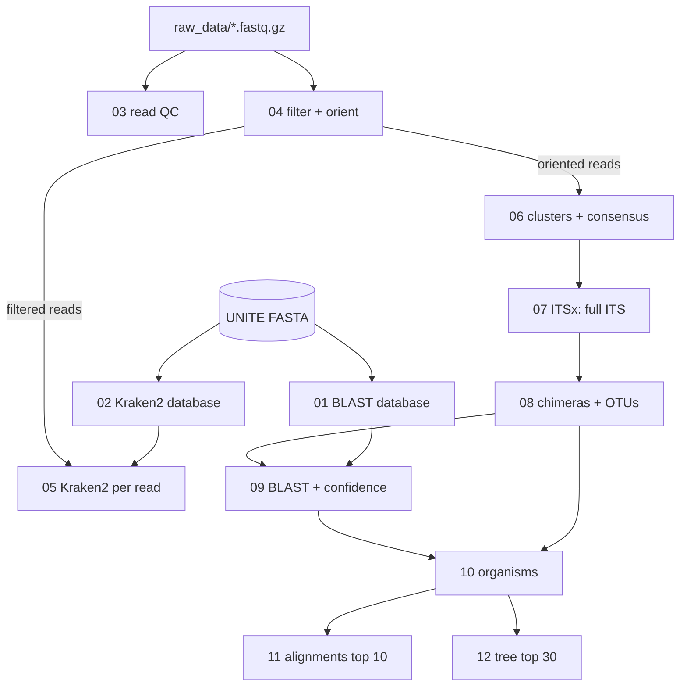

# FungiFlowRemastered

A pipeline that identifies the fungi in Oxford Nanopore ITS amplicon reads from
air samples. It turns raw reads into accurate consensus sequences, groups them
into OTUs, identifies them against UNITE with BLAST, counts organisms per
sample, aligns the most abundant organisms across samples and builds a
phylogenetic tree.

Every step is one plain bash script in [`scripts/`](scripts/), run inside a
Docker container. All settings live in one file, [`config.sh`](config.sh).
Each step writes its files to `results/NN_<step>/` and a log of what it printed
to `logs/NN_<step>.log`.

## Contents

- [The flow at a glance](#the-flow-at-a-glance)
- [Project layout](#project-layout)
- [Setup](#setup)
- [Running the pipeline](#running-the-pipeline)
- [The app (upload, run, view)](#the-app-upload-run-view)
- [Desktop app](#desktop-app)
- [Settings](#settings)
- [Steps](#steps): [01](#01-blast-database) · [02](#02-kraken2-database) ·
  [03](#03-read-quality) · [04](#04-filter-and-orient-reads) ·
  [05](#05-kraken2-classification-of-reads) · [06](#06-clusters-and-consensus-sequences) ·
  [07](#07-full-its-with-itsx) · [08](#08-chimeras-and-otus) ·
  [09](#09-blast-identification) · [10](#10-organisms) ·
  [11](#11-alignments-of-the-top-organisms) · [12](#12-phylogenetic-tree)
- [Names and formats used everywhere](#names-and-formats-used-everywhere)
- [Known issues and open questions](#known-issues-and-open-questions)

## The flow at a glance



In words:

| step | question it answers | main output |
|---|---|---|
| 01–02 | (databases) | `database/blast/`, `database/kraken2/` |
| 03 | What do the raw reads look like? | `results/03_read_qc/read_stats.tsv` |
| 04 | Which reads are good enough, and on which strand? | `results/04_filter_orient/<sample>.oriented.fastq.gz` |
| 05 | What is in each sample, read by read? | `results/05_kraken2/genus_reads.tsv` |
| 06 | What are the accurate sequences behind the reads? | `results/06_clusters/<sample>.consensus.fasta` |
| 07 | Which of them contain the whole ITS? | `results/07_itsx/<sample>.its.fasta` |
| 08 | Which are chimeras, and which belong to the same organism across samples? | `results/08_otus/otu_table.tsv` |
| 09 | What is each OTU, and how sure are we? | `results/09_blast/taxonomy.tsv` |
| 10 | How many organisms, in which samples? | `results/10_organisms/organisms.tsv` |
| 11 | Does the same organism have the same ITS in every sample? | `results/11_alignments/summary.tsv` |
| 12 | How are the main organisms related? | `results/12_tree/tree.treefile` |

## Project layout

```
FungiFlowRemastered/
├── README.md
├── config.sh                    all settings, read by every script
├── run_pipeline.sh              steps 03-12 for one run folder
├── start.sh                     starts the browser app (builds missing images)
├── scripts/
│   ├── 01_build_blast_db.sh … 12_tree.sh   one script per step
│   └── py/                      Python helpers called by the scripts
│       ├── unite_to_kraken.py   (step 02)
│       ├── kraken_summary.py    (step 05)
│       ├── assign_taxonomy.py   (step 09)
│       ├── organisms.py         (step 10)
│       └── compare_alignment.py (step 11)
├── viz/                         the app page and the R pictures (run in image fungiflow-viz)
│   ├── app.R, runs.R            the page; run folders, start/stop, status
│   ├── tree.R, plots.R          one function per picture
│   └── install.R                R packages, for running the pictures without Docker
├── desktop/                     Electron desktop app (main.js, package.json)
├── docker/                      every image, one folder each
│   ├── pipeline/                fungiflow-remastered: Dockerfile, environment.yml (all steps except 06)
│   ├── ngspeciesid/             fungiflow-ngspeciesid: Dockerfile, environment.yml (step 06)
│   ├── viz/                     fungiflow-viz: Dockerfile (R, Shiny, ggtree)
│   └── compose.yml              the browser app container, used by start.sh
├── .github/workflows/           images.yml (Docker images), desktop.yml (installers)
├── docs/                        kroki_08_09_10.md, steps 08-10 explained in Polish
├── explore/                     one-off tests used to choose settings (not part of the pipeline)
├── database/
│   ├── unite/                   UNITE download (.tgz in git, extracted .fasta not)
│   ├── blast/                   built by step 01 (not in git)
│   └── kraken2/                 built by step 02 (not in git)
├── runs/<name>/                 one folder per run started from the app (not in git)
├── raw_data/                    <sample>.fastq.gz, one file per barcode (private, never in git)
├── results/                     everything the steps produce (not in git)
└── logs/                        one log per step (not in git)
```

What git keeps and ignores is set in [`.gitignore`](.gitignore). The reads
in `raw_data/` are private and must never be committed. The `.gitkeep` files
keep the empty folders in the repository.

## Setup

### 1. Data

- Put one FASTQ per sample in `raw_data/`, named `<sample>.fastq.gz`
  (e.g. `raw_data/barcode25.fastq.gz`). The file name becomes the sample name
  everywhere.
- Extract the UNITE release into `database/unite/`. The pipeline uses the
  **all eukaryotes, dynamic** file:
  `database/unite/sh_general_release_dynamic_all_19.02.2025.fasta`
  (the path is set as `UNITE_FASTA` in [`config.sh`](config.sh)).

### 2. Docker images

Two images for the pipeline, because NGSpeciesID and medaka need versions of
Python packages that clash with the other tools, and one for the app.

| image | built from | tools | used by |
|---|---|---|---|
| `fungiflow-remastered` | [`docker/pipeline/Dockerfile`](docker/pipeline/Dockerfile), [`docker/pipeline/environment.yml`](docker/pipeline/environment.yml) | Python 3.12, BLAST, Kraken2, seqkit, chopper, vsearch, ITSx, MAFFT, IQ-TREE | every step except 06 |
| `fungiflow-ngspeciesid` | [`docker/ngspeciesid/Dockerfile`](docker/ngspeciesid/Dockerfile), [`docker/ngspeciesid/environment.yml`](docker/ngspeciesid/environment.yml) | NGSpeciesID, medaka (+ the medaka model, downloaded at build), seqkit | step 06 |
| `fungiflow-viz` | [`docker/viz/Dockerfile`](docker/viz/Dockerfile) | R 4.4, Shiny, ggplot2, ape, ggtree, docker command line | the app and the pictures |

Build them from the project root (`start.sh` does this for you):

```bash
docker build -t fungiflow-remastered docker/pipeline
docker build -t fungiflow-ngspeciesid docker/ngspeciesid
docker build -t fungiflow-viz docker/viz
```

## Running the pipeline

Always run from the project root. The general pattern is:

```bash
docker run --rm --user "$(id -u):$(id -g)" -v "$PWD":/data fungiflow-remastered bash scripts/NN_name.sh
```

- `--rm` deletes the container when it finishes (the results stay, they are on your disk).
- `--user "$(id -u):$(id -g)"` makes the new files yours, not root's.
- `-v "$PWD":/data` puts the project folder inside the container at `/data`,
  which is the container's working directory.

All steps in order:

```bash
IMG="docker run --rm --user $(id -u):$(id -g) -v $PWD:/data fungiflow-remastered"
UNITE=database/unite/sh_general_release_dynamic_all_19.02.2025.fasta

$IMG bash scripts/01_build_blast_db.sh "$UNITE"
$IMG bash scripts/02_build_kraken_db.sh "$UNITE"
$IMG bash scripts/03_read_qc.sh
$IMG bash scripts/04_filter_orient.sh
$IMG bash scripts/05_kraken2.sh
docker run --rm --user "$(id -u):$(id -g)" -e HOME=/tmp -v "$PWD":/data \
    fungiflow-ngspeciesid bash scripts/06_cluster_consensus.sh
$IMG bash scripts/07_itsx.sh
$IMG bash scripts/08_otus.sh
$IMG bash scripts/09_blast.sh
$IMG bash scripts/10_organisms.sh
$IMG bash scripts/11_align.sh
$IMG bash scripts/12_tree.sh
```

Notes:

- **Step 06 takes hours** (about 6 h 40 min for 10 samples on 6 cores). Run it in
  the background and follow the log:
  ```bash
  nohup docker run --rm --user "$(id -u):$(id -g)" -e HOME=/tmp -v "$PWD":/data \
      fungiflow-ngspeciesid bash scripts/06_cluster_consensus.sh > /dev/null 2>&1 &
  tail -f logs/06_cluster_consensus.log
  ```
  `-e HOME=/tmp` gives medaka a writable home folder.
- **Rerunning.** Steps 04–07 skip samples whose output already exists, so an
  interrupted run continues where it stopped. To redo a sample, delete its output
  files. Steps 08–12 always recompute everything (they take seconds to minutes).
  Step 02 refuses to overwrite an existing `database/kraken2/`; delete it to rebuild.
- **Checking a script without running it:** `bash -n scripts/NN_name.sh`
  reports syntax errors only.
- **Fewer threads:** every script uses all cores by default; prefix with
  `-e THREADS=4` in `docker run` to limit it.

## The app (upload, run, view)

A browser page for people who do not want the command line. It runs on your
own computer with Docker. Start it from the project root:

```bash
bash start.sh               # builds the missing images, then starts the app
bash start.sh --rebuild     # after changing a Dockerfile or environment.yml
docker compose -f docker/compose.yml down   # stop the app
```

Open http://127.0.0.1:3838.

- **Run tab:** create a run (a name such as `air_2025`), add the barcode
  files (`.fastq.gz`, the file name becomes the sample name), press **Start
  pipeline**. The table shows each step as running, done, failed, stopped or
  interrupted; below it is the end of the log, refreshed every 3 seconds.
  Step 06 takes hours. Closing the browser does not stop the run. **Start**
  again after a stop continues, because steps 04–07 skip finished samples.
- **Pictures tab:** pick a run (or `(main project)`, the results in the
  project root) and a picture. Download PDF saves the current view.

| picture | made from | function |
|---|---|---|
| Tree | `results/12_tree/tree.treefile` | `draw_tree` in [`viz/tree.R`](viz/tree.R) |
| Circular tree with reads | the tree + barcode columns of `organisms.tsv`, one ring per barcode | `draw_circular` in [`viz/plots.R`](viz/plots.R) |
| Organism heatmap | `results/10_organisms/organisms.tsv` | `draw_heatmap` |
| PCA of barcodes | `organisms.tsv`, all organisms, Hellinger transform (square root of each organism's share of the barcode), then `prcomp` | `draw_pca` |
| Organisms per barcode | `results/10_organisms/per_sample.tsv` | `draw_per_sample` |
| Same ITS in the top 10 | `results/11_alignments/summary.tsv` | `draw_same_its` |

In the PCA, barcodes that lie close together have similar organism shares.
The arrows are the organisms that pull barcodes apart the most. Hellinger is
used because read depth differs between barcodes, and raw counts would mostly
show depth.

How it is put together:

- Each run is a folder `runs/<name>/` that works like a small copy of the
  project: its own `raw_data/`, `results/`, `logs/`, `config.sh` (copied at
  the first start, so you can edit settings for that run) and `status.tsv`.
  `scripts/` and `database/` are links to the shared ones. `runs/` is in
  `.gitignore`, because it holds the reads.
- [`run_pipeline.sh`](run_pipeline.sh) runs steps 03–12 for one run, each step
  in its own container (`fungiflow_<run>_<step>`). It builds the
  databases (01–02) first if they are missing, and unpacks UNITE if needed.
  It also works from a terminal: `bash run_pipeline.sh <run name>`.
- The app ([`viz/app.R`](viz/app.R), run helpers in [`viz/runs.R`](viz/runs.R))
  is the `fungiflow-viz` image started by
  [`docker/compose.yml`](docker/compose.yml). It talks to Docker through
  `/var/run/docker.sock`. **Start** launches `run_pipeline.sh` in a separate
  container (`fungiflow_runner_<run>`), so the run keeps going when the app
  restarts. `start.sh` passes your user id (`RUN_AS`), so the new files are
  yours. It also passes the project's host path (`HOST_PROJECT`) and the
  socket's group (`DOCKER_GID`).
- Without the app: `Rscript viz/tree.R` and `Rscript viz/plots.R` (after
  `Rscript viz/install.R`, or inside `fungiflow-viz`) write all pictures to
  `results/viz/`.

## Desktop app

The same page in its own window, installed from GitHub Releases. Nothing
needs to be built or cloned.

**For users**

1. Install [Docker Desktop](https://www.docker.com/products/docker-desktop/)
   (on Linux: Docker Engine) and start it once. The pipeline tools only run in
   Linux containers, so FungiFlow cannot work without it.
2. Download the installer for your system from the
   [Releases page](https://github.com/gabost10297/FungiFlowRemastered/releases):
   `FungiFlow Setup <version>.exe` (Windows), `FungiFlow-<version>.dmg` or
   `FungiFlow-<version>-arm64.dmg` (Intel or Apple Silicon Mac),
   `FungiFlow-<version>.AppImage` (Linux).
3. Open FungiFlow. At the first start it:
   - starts Docker Desktop if it is not running;
   - downloads the three images (about 9 GB, once per version);
   - creates the FungiFlow folder.

   The first run then unpacks UNITE and builds the BLAST and Kraken2 databases
   (a few minutes).

The installers are not signed. Windows shows "Windows protected your PC":
choose More info, then Run anyway. On macOS, right-click the app, choose Open,
then Open.

Everything is kept in one folder:

| system | folder |
|---|---|
| Windows | `Documents\FungiFlow`, or `C:\Users\<name>\FungiFlow` when OneDrive syncs Documents |
| macOS, Linux | `~/Documents/FungiFlow` |

It has the same layout as this repository: `runs/<name>/` with the reads and
results, `database/`, `scripts/`, and `config.sh`, which you can edit. **File →
Open FungiFlow folder** opens it. A new app version replaces `scripts/` and
`viz/`, but keeps `config.sh`, `database/` and `runs/`.

Closing the window stops the page. A running pipeline keeps going as long as
Docker runs; open FungiFlow again to follow it. On an Apple Silicon Mac the
images run through emulation, so step 06 is slower.

**How it works** ([`desktop/`](desktop/), Electron)

- [`desktop/main.js`](desktop/main.js) checks Docker, copies the bundled
  scripts into the folder, and pulls `ghcr.io/gabost10297/<image>:<version>`.
  It retags each image with its short name (`fungiflow-remastered` and so on),
  then starts `fungiflow-app` on `127.0.0.1:38380` and shows it in the window.
- Folder paths differ between systems (Docker cannot read a `C:\...` path
  given from inside a container). So the folder is mounted once, into a
  container that is created but never started: `fungiflow-data`. The page,
  the runner and every step take it with `--volumes-from fungiflow-data`
  (`DATA_CONTAINER` in [`run_pipeline.sh`](run_pipeline.sh) and
  [`viz/runs.R`](viz/runs.R)).
- On Windows and macOS the containers run as root, because Docker Desktop
  writes files as the logged-in user anyway. On Linux they run as the user.
- Development: `cd desktop && npm install && npm start`. Set
  `FUNGIFLOW_LOCAL_IMAGES=1` to use images built with `docker build` instead
  of downloading them.

**Publishing a new version**

1. Set the same version in [`desktop/package.json`](desktop/package.json),
   for example `1.0.1`, and commit.
2. `git tag v1.0.1 && git push origin v1.0.1`.
3. Two GitHub Actions workflows start:
   - [`images.yml`](.github/workflows/images.yml) builds the three images and
     pushes them to GitHub Container Registry as `:1.0.1` and `:latest`;
   - [`desktop.yml`](.github/workflows/desktop.yml) builds the Windows, macOS
     and Linux installers and attaches them to the release `v1.0.1`.
4. First release only: on GitHub, open your profile → Packages, then for each
   of the three images choose Package settings → Change visibility → Public.
   Otherwise the app cannot download them.

The images contain only the tools: no reads, no UNITE, no results.

## Settings

All in [`config.sh`](config.sh), grouped by step. Every script starts with
`source config.sh`, except 01–03 which only need their input path.

| setting | value | step | meaning |
|---|---|---|---|
| `THREADS` | all cores | all | CPU threads |
| `UNITE_FASTA` | `database/unite/sh_general_release_dynamic_all_19.02.2025.fasta` | 04 | reference for orienting reads |
| `BLAST_DB` | `database/blast/unite` | 09 | BLAST database prefix |
| `KRAKEN_DB` | `database/kraken2` | 05 | Kraken2 database folder |
| `MIN_QUAL` | 10 | 04, 06 | minimum average read quality |
| `MIN_LEN`, `MAX_LEN` | 400, 1200 | 04 | read length window (bp) |
| `KRAKEN_CONFIDENCE` | 0 | 05 | Kraken2 confidence score (0 = no extra filter) |
| `KRAKEN_MIN_HITS` | 3 | 05 | separate k-mer hit groups needed to classify a read |
| `MEDAKA_MODEL` | `r1041_e82_400bps_hac_v5.2.0` | 06 | must match the basecaller model |
| `MIN_CLUSTER_SIZE` | 20 | 06 | smallest cluster (reads) that gets a consensus |
| `MAX_SEQS_CONSENSUS` | 300 | 06 | reads used to build one consensus |
| `CLUSTER_READS` | 0 | 06 | reads per sample to cluster (0 = all) |
| `ITSX_EVALUE` | 1e-2 | 07 | ITSx domain E-value (default 1e-5 misses the short LSU end) |
| `OTU_IDENTITY` | 0.985 | 08 | OTU clustering identity (UNITE species level) |
| `BLAST_HIGH_PIDENT`, `BLAST_HIGH_QCOV` | 99, 92 | 09 | high confidence species (mentor's thresholds) |
| `BLAST_LOW_PIDENT`, `BLAST_LOW_QCOV` | 97, 85 | 09 | low confidence species (mentor's thresholds) |
| `BLAST_GENUS_PIDENT`, `BLAST_GENUS_QCOV` | 90, 75 | 09 | genus only |
| `BLAST_AMBIGUOUS_GAP` | 0.5 | 09 | another species within this many % identity = ambiguous |
| `BLAST_MIN_REF_COV` | 85 | 09 | flag hits covering less of the reference than this (%) |
| `TOP_ORGANISMS` | 10 | 10, 11 | organisms aligned in step 11 |
| `SAME_ITS_IDENTITY` | 98.5 | 11 | identity counted as "the same ITS" |
| `LENGTH_DIFF` | 20 | 11 | report sequences this many bp longer/shorter than the representative |
| `TREE_ORGANISMS` | 30 | 12 | organisms in the tree |
| `TREE_BOOTSTRAP` | 1000 | 12 | ultrafast bootstrap replicates |

---

## Steps

Each step below lists: what it does and why, the script, inputs, outputs (with
the columns of every table), and what to look at. "Current results" are from
the 10 air samples (barcode25, 31, 33, 41, 49, 57, 65, 73, 81, 89).

### 01 BLAST database

**Why:** step 09 compares every OTU with UNITE using BLAST, which needs UNITE
in its own indexed format.

- **Script:** [`scripts/01_build_blast_db.sh`](scripts/01_build_blast_db.sh) `<unite.fasta>`
- **Tools:** `seqkit stats` (counts the input), `makeblastdb -dbtype nucl`,
  `blastdbcmd -info` (checks the result).
- **Input:** the UNITE FASTA given on the command line.
- **Output:** `database/blast/unite.*` (8 index files; `unite` is the name the
  other steps use, see `BLAST_DB`).
- **Log:** `logs/01_build_blast_db.log` — the number of sequences in the
  FASTA and in the database must be the same (156,820).

### 02 Kraken2 database

**Why:** Kraken2 needs a taxonomy tree (NCBI style `nodes.dmp`/`names.dmp`)
and sequences labelled with tax IDs. UNITE only has lineage strings in its
headers (`k__Fungi;p__Ascomycota;…;s__Name`), so a converter builds both.

- **Script:** [`scripts/02_build_kraken_db.sh`](scripts/02_build_kraken_db.sh) `<unite.fasta>`
- **Helper:** [`scripts/py/unite_to_kraken.py`](scripts/py/unite_to_kraken.py)
  - reads each UNITE header, turns the lineage into ranks
    (`parse_lineage`), skips placeholder names such as `unidentified` or
    `…_sp` (`is_placeholder`), so such sequences are labelled at the last real rank;
  - gives every taxon a tax ID, keyed by (parent, rank, name), so the same name
    under two different parents stays two taxa;
  - writes `taxonomy/nodes.dmp`, `taxonomy/names.dmp` and `library.fasta` with
    headers `>ACCESSION_N|kraken:taxid|TAXID`.
- **Then:** `kraken2-build --add-to-library`, `kraken2-build --build`,
  `kraken2-inspect`.
- **Output:** `database/kraken2/` — `hash.k2d`, `opts.k2d`, `taxo.k2d` (the
  database), `taxonomy/`, `library.fasta`, `seqid2taxid.map`, and
  `inspect.txt` (number of sequences per taxon, a quick check).
- **Log:** `logs/02_build_kraken_db.log` — 156,820 sequences, 73,418 labelled
  to species, 78,014 taxa; ranks listed must be kingdom…species.
- **Note:** these tax IDs are this pipeline's own, not NCBI's.

### 03 Read quality

**Why:** to see the raw data before anything is removed, and to choose the
filter settings for step 04.

- **Script:** [`scripts/03_read_qc.sh`](scripts/03_read_qc.sh) `[input_dir]` (default `raw_data`)
- **Input:** `raw_data/*.fastq.gz`
- **Output:** `results/03_read_qc/`
  - `read_stats.tsv` — `seqkit stats --all` per sample: `num_seqs` (reads),
    `sum_len`, `min_len`, `avg_len`, `max_len`, `Q1`/`Q2`/`Q3` (**length**
    quartiles, Q2 = median length — not quality), `N50`, `Q20(%)`, `Q30(%)`
    (bases at ≥Q20/≥Q30), `AvgQual`, `GC(%)`.
  - `length_quality_classes.tsv` — % of reads per length class (`len_lt300`,
    `len_300_499`, `len_500_899`, `len_ge900`) and average quality class
    (`q_lt10`, `q_10_14`, `q_15_19`, `q_ge20`).
- **Current results:** 73,668–185,555 reads per sample, median length
  316–395 bp, average quality Q11.2–11.6; 24–30% of reads below Q10 and
  32–46% shorter than 300 bp (too short for a full ITS).

### 04 Filter and orient reads

**Why:** keep reads that can contain a complete ITS, and turn them all to the
same strand. In the raw data about half of the reads are reverse complemented;
consensus building (step 06) needs them in one direction.

- **Script:** [`scripts/04_filter_orient.sh`](scripts/04_filter_orient.sh) `[input_dir]` (default `raw_data`)
- **Settings:** `MIN_QUAL`, `MIN_LEN`, `MAX_LEN`, `UNITE_FASTA`
- **What happens per sample:**
  1. `chopper --quality 10 --minlength 400 --maxlength 1200` → filtered reads;
  2. `vsearch --orient --db UNITE` compares each read with UNITE in both
     directions and reverse-complements those matching the opposite strand.
- **Input:** `raw_data/<sample>.fastq.gz`
- **Output:** `results/04_filter_orient/`
  - `<sample>.filtered.fastq.gz` — passed quality and length (input of step 05)
  - `<sample>.oriented.fastq.gz` — filtered and oriented (input of step 06)
  - `<sample>.unoriented.fastq.gz` — filtered, but no UNITE match in either direction
  - `summary.tsv` — `raw`, `filtered`, `oriented`, `unoriented` reads and
    `pct_kept` (oriented / raw × 100)
- **Current results:** 36–43% of reads kept; barcode65 only 10.9% (most of its
  filtered reads match nothing in UNITE).
- **Note:** adapters, barcodes and primers are **not** trimmed from reads (the
  primers are unknown). About 155–220 bp of adapter, barcode and the end of the
  SSU (18S) gene come before ITS1. This does not disturb clustering, and step 07
  cuts the ITS out of the consensuses.

### 05 Kraken2 classification of reads

**Why:** an independent, read-by-read view of each sample (Kraken2, as
suggested by the mentor). It does not feed later steps; it is a check on them.

- **Script:** [`scripts/05_kraken2.sh`](scripts/05_kraken2.sh)
- **Helper:** [`scripts/py/kraken_summary.py`](scripts/py/kraken_summary.py)
  turns the reports into the two summary tables.
- **Settings:** `KRAKEN_DB`, `KRAKEN_CONFIDENCE`, `KRAKEN_MIN_HITS`
- **Input:** `results/04_filter_orient/<sample>.filtered.fastq.gz` (filtered, not
  oriented — Kraken2 checks both strands itself)
- **Output:** `results/05_kraken2/`
  - `<sample>.reads.tsv.gz` — standard Kraken2 output, one line per read:
    `C`/`U` (classified or not), read ID, tax ID, read length, k-mer hits.
  - `<sample>.report.txt` — standard Kraken2 report: % of reads in the clade,
    reads in the clade, reads assigned directly, rank code (U, R, K, P, C, O, F, G, S),
    tax ID, indented name.
  - `classification.tsv` — per sample: `reads`, `pct_classified`, `pct_Fungi`,
    `pct_Viridiplantae` (plants), `pct_Metazoa` (animals).
  - `genus_reads.tsv` — reads per genus (rows) and sample (columns), with
    `total`, most abundant first.
- **Current results:** 97–99.8% classified (barcode65: 58%, with 10% Metazoa);
  plants 11.6% in barcode73 and 23% in barcode81 (mostly *Urtica*). Top genera:
  *Cladosporium*, *Neoascochyta*, *Sporobolomyces*.
- **Note:** each read is classified on its own, with about 5% sequencing errors,
  so species-level calls here are less reliable than BLAST of consensuses (step 09).

### 06 Clusters and consensus sequences

**Why:** Nanopore reads here have about 5% errors (median from the NGSpeciesID
logs: 4.9–5.1%). Two reads of the same species therefore differ by ~10%,
so reads cannot be compared with each other or with UNITE at species level
directly. Reads of the same organism are first grouped, and each group gives
one accurate consensus sequence. (Clustering reads directly at 98% was tested
and fails: 10,000 reads gave 9,995 clusters — see
[`explore/06_test_clustering.sh`](explore/06_test_clustering.sh).)

- **Script:** [`scripts/06_cluster_consensus.sh`](scripts/06_cluster_consensus.sh)
  (runs in the `fungiflow-ngspeciesid` image)
- **Tool:** NGSpeciesID: isONclust (clustering) → spoa (consensus) → medaka
  (polishing with the Nanopore error model `MEDAKA_MODEL`).
- **Settings:** `MEDAKA_MODEL`, `MIN_CLUSTER_SIZE`, `MAX_SEQS_CONSENSUS`,
  `CLUSTER_READS`, `MIN_QUAL`
- **How:** each sample on its own; all oriented reads are used; NGSpeciesID's
  `--abundance_ratio` is set to `MIN_CLUSTER_SIZE / reads`, so only clusters
  of at least 20 reads get a consensus; `--seed 1` makes runs repeatable.
  The work folder `results/06_clusters/work_<sample>/` exists only while a
  sample runs.
- **Input:** `results/04_filter_orient/<sample>.oriented.fastq.gz`
- **Output:** `results/06_clusters/`
  - `<sample>.consensus.fasta` — one consensus per cluster, header
    `>barcode25_cl7;size=1150` (cluster 7 of barcode25, built from 1,150 reads)
  - `<sample>.ngspeciesid.log` — NGSpeciesID's own log (includes read error rates)
  - `<sample>.reads.tsv` — sample, reads available, reads used
  - `summary.tsv` — `reads_available`, `reads_used`, `consensuses`,
    `reads_in_consensuses`, `pct_in_consensuses`
- **Current results:** 1,181 consensuses (9–220 per sample) holding 95–99% of
  the reads. Organisms with fewer than 20 reads in a sample get no consensus.

### 07 Full ITS with ITSx

**Why:** keep only ITS1-5.8S-ITS2, without the SSU/LSU ends and adapters, so
that BLAST coverage and comparisons between samples are about the same region.

- **Script:** [`scripts/07_itsx.sh`](scripts/07_itsx.sh)
- **Tool:** `ITSx -E 1e-2 --preserve T --save_regions all` (`ITSX_EVALUE`).
  With the default E-value (1e-5) ITSx missed the short LSU piece at the end
  of many consensuses and rejected them.
- **Input:** `results/06_clusters/<sample>.consensus.fasta`
- **Output:** `results/07_itsx/`
  - `<sample>.its.fasta` — full ITS of every consensus in which ITSx found it
    (headers unchanged, `size=` kept) — **input of step 08**
  - `itsx/<sample>.*` — everything ITSx writes: single regions
    (`.SSU.fasta`, `.ITS1.fasta`, `.5_8S.fasta`, `.ITS2.fasta`, `.LSU.fasta`),
    `.full.fasta`, `.positions.txt` (where each region starts and ends in every
    consensus — the best file for checking odd sequences), `.summary.txt`,
    `.problematic.txt`, `_no_detections.fasta`, `.chimeric.fasta`
  - `summary.tsv` — `consensuses`, `full_ITS`, `ITS1_found`, `ITS2_found`,
    `no_ITS`, `reads`, `reads_full_ITS`, `pct_reads_full_ITS`
- **Current results:** 764 of 1,181 consensuses have the full ITS (80–95% of
  reads). barcode65: 0 — it drops out here.

### 08 Chimeras and OTUs

**Why:** (1) PCR chimeras (sequences glued from two templates) look like new
organisms and must go; (2) the same organism has its own consensus in every
sample, and these must be joined to compare samples.

- **Script:** [`scripts/08_otus.sh`](scripts/08_otus.sh)
- **Settings:** `OTU_IDENTITY`
- **How:**
  1. per sample: `vsearch --uchime_denovo --sizein` (chimeras form within one
     PCR, and more abundant sequences are the possible parents). Borderline
     sequences are **kept**;
  2. all samples together: `;sample=<sample>` is added to the headers and
     `vsearch --cluster_size --id 0.985 --sizein --sizeout` joins sequences
     at ≥98.5% identity, starting from the most abundant. Each OTU is named
     after its most abundant consensus (the centroid).
- **Input:** `results/07_itsx/<sample>.its.fasta`
- **Output:** `results/08_otus/`
  - `chimeras/<sample>.ok.fasta`, `.borderline.fasta`, `.chimeras.fasta` — the split
  - `chimeras/<sample>.uchime.tsv` — full UCHIME output (score, parents, verdict Y/N/?)
  - `chimeras/summary.tsv` — `sequences`, `borderline`, `chimeras`, `reads`,
    `reads_borderline`, `reads_in_chimeras` (the `sequences` column adds up to
    the step 07 total)
  - `all_its.fasta` — every chimera-free ITS of all samples, header
    `>barcode25_cl7;size=1150;sample=barcode25`
  - `otus.fasta` — one sequence per OTU (the centroid)
  - `otu_table.tsv` — **the OTU table**: reads per OTU (rows) and sample (columns)
  - `members.tsv` — `otu`, `consensus`, `sample`, `reads`, `identity_to_otu`:
    which consensus of which sample joined which OTU
  - `otus.uc` — raw vsearch clustering output (`S` = centroid, `H` = member)
- **Current results:** 82 chimeras (3.6% of reads), 8 borderline kept →
  682 sequences → **538 OTUs**. barcode65 is absent from here on.

### 09 BLAST identification

**Why:** give each OTU a name and say how sure that name is.

- **Script:** [`scripts/09_blast.sh`](scripts/09_blast.sh)
- **Helper:** [`scripts/py/assign_taxonomy.py`](scripts/py/assign_taxonomy.py)
- **Settings:** all `BLAST_*`
- **How:** `blastn -max_target_seqs 10 -max_hsps 1 -evalue 1e-10` of
  `otus.fasta` against `database/blast/unite`. Then for each OTU the best hit
  (highest bitscore) decides:

  | confidence | identity | query coverage | named to |
  |---|---|---|---|
  | high | ≥ 99% | ≥ 92% | species |
  | low | ≥ 97% | ≥ 85% | species |
  | genus | ≥ 90% | ≥ 75% | genus |
  | unassigned | lower | | — |
  | no_hit | no BLAST hit | | — |

  Two flags:
  - **ambiguous** — the best hit to a *different* species is less than 0.5
    percentage points worse. The name is then moved up to the deepest rank both
    hits share (`shared_rank`), e.g. *Alternaria* instead of *Alternaria alternata*.
  - **partial_ref** — the alignment covers less than 85% of the reference
    sequence (`ref_cov`). Short UNITE references also explain OTUs with 100%
    identity but low query coverage.
- **Input:** `results/08_otus/otus.fasta`, `results/08_otus/otu_table.tsv`
- **Output:** `results/09_blast/`
  - `blast_hits.tsv` — up to 10 hits per OTU, no header; columns `qseqid`,
    `sseqid` (full UNITE header with lineage), `pident`, `length`, `qstart`,
    `qend`, `qlen`, `sstart`, `send`, `slen`, `evalue`, `bitscore`, `qcovhsp`
  - `taxonomy.tsv` — one row per OTU, most reads first: `otu`, `reads`,
    `samples`, `confidence`, `rank` (rank of the given name), `name`,
    `best_species` (species of the best hit), `pident`, `qcov`, `ref_cov`,
    `second_species`, `second_pident` (best *other* species), `ambiguous`,
    `partial_ref`, `kingdom` … `genus`
- **Current results:**

  | confidence | OTUs | % reads |
  |---|---|---|
  | high | 110 | 60.6% |
  | low | 152 | 11.3% |
  | genus | 190 | 23.8% |
  | unassigned | 86 | 4.3% |

### 10 Organisms

**Why:** several OTUs can carry the same name (e.g. six *Cladosporium
herbarum* OTUs). This step joins them into organisms, counts organisms per
sample, picks a representative for each, and the top organisms for steps 11–12.

- **Script:** [`scripts/10_organisms.sh`](scripts/10_organisms.sh)
- **Helper:** [`scripts/py/organisms.py`](scripts/py/organisms.py)
- **Settings:** `TOP_ORGANISMS`
- **Rules:**
  - Every OTU goes into one group (`group_of`): `organism` (fungal, high or low
    confidence), `genus_only` (fungal, genus confidence), `non_fungal`
    (plants etc.), `unassigned`. Only `organism` OTUs are counted as organisms.
  - Joining (`organism_key`): the same species name → one organism; a
    genus-level name (ambiguous cases) → one "*Genus* sp."; an unnamed
    reference (`Pleosporales_sp`) or a higher rank → one organism **per OTU**,
    numbered by reads ("Pleosporales sp. 1", "… sp. 2"), because two such OTUs
    may be two different unnamed species.
  - Representative of an organism: the OTU with the highest identity, then
    query coverage, then reads.
  - Ranking: total reads in all samples.
- **Input:** `results/09_blast/taxonomy.tsv` and, from `results/08_otus/`:
  `otu_table.tsv`, `otus.fasta`, `all_its.fasta`, `members.tsv`
- **Output:** `results/10_organisms/`
  - `organisms.tsv` — one row per organism: `position` (rank by reads),
    `organism`, `otus`, `reads`, `samples`, reads per sample, `representative`
    (OTU) with its `pident`, `qcov`, `ref_cov`, `confidence`, `kingdom` … `genus`
  - `otu_groups.tsv` — every OTU with its `group` and `organism`
  - `per_sample.tsv` — `reads` (in the OTU table), `organism_reads`,
    `organisms`, `only_in_this_sample`
  - `representatives.fasta` — one sequence per organism, most reads first,
    header `>Cladosporium_herbarum otu=barcode31_cl0 pident=99.78 qcov=98`
  - `top/NN_<organism>.fasta` — for each of the top organisms, **all**
    consensuses from all samples that belong to it (input of step 11)
- **Current results:** 252 OTUs (69% of reads) → **202 organisms**, 138 of
  them in one sample only; 19 (barcode31) to 78 (barcode57) organisms per sample.
  Top 10: *Cladosporium herbarum*, *Neoascochyta graminicola*, *Sporobolomyces
  roseus*, *Alternaria* sp., *Microdochium nivale*, *Neoascochyta exitialis*,
  *Ganoderma applanatum*, Pleosporales sp. 1, *Botrytis caroliniana*,
  Phaeosphaeriaceae sp. 1.

### 11 Alignments of the top organisms

**Why:** answers the mentor's question whether "the same" organism really has
the same ITS sequence in different samples.

- **Script:** [`scripts/11_align.sh`](scripts/11_align.sh)
- **Helper:** [`scripts/py/compare_alignment.py`](scripts/py/compare_alignment.py)
- **Settings:** `SAME_ITS_IDENTITY`, `LENGTH_DIFF`
- **How:** `mafft --auto` aligns each `top/NN_<organism>.fasta`. Then every
  sequence is compared with the organism's representative (from
  `organisms.tsv`). Only the stretch both sequences cover is compared
  (`compare`), so a sequence that is just longer at one end does not count as
  different; its extra length is reported separately. Each column that differs
  (another base or a gap) is one difference.
- **Input:** `results/10_organisms/top/*.fasta`, `results/10_organisms/organisms.tsv`
- **Output:** `results/11_alignments/`
  - `NN_<organism>.aln.fasta` — MAFFT alignments; open them in an alignment
    viewer (AliView, Jalview) to see the differences
  - `vs_representative.tsv` — every sequence: `organism`, `sequence`, `sample`,
    `otu`, `reads`, `representative` (yes/no), `length`, `length_diff`
    (vs the representative), `differences`, `identity`
  - `summary.tsv` — per organism: `representative`, `sequences`, `samples`,
    `min_identity`, `below_98.5` (sequences), `pct_reads_at_least_98.5`,
    `length_diff_over_20` (sequences)
- **Current results:** *Sporobolomyces roseus*, *Microdochium nivale*,
  *Neoascochyta exitialis* and Pleosporales sp. 1 have the same ITS in all
  samples (100% of reads ≥98.5%). *N. graminicola* 96%, *Ganoderma* 92%,
  *Botrytis* 88%, *Cladosporium herbarum* 80% (probably several species of the
  *C. herbarum* complex). "*Alternaria* sp." 0.3%: it joins different species.

### 12 Phylogenetic tree

**Why:** show how the most abundant organisms are related.

- **Script:** [`scripts/12_tree.sh`](scripts/12_tree.sh)
- **Settings:** `TREE_ORGANISMS`, `TREE_BOOTSTRAP`
- **How:**
  1. the first `TREE_ORGANISMS` sequences of `representatives.fasta` (it is
     sorted by reads), headers cut to the name (`seqkit seq -i`);
  2. `mafft --localpair --maxiterate 1000` (L-INS-i, the most accurate mode,
     fine for 30 sequences);
  3. `iqtree3 -m MFP -B 1000 --seed 1`: ModelFinder picks the substitution
     model, then maximum likelihood tree with ultrafast bootstrap;
  4. rooted with `-o` on all Basidiomycota in the tree (the phylum is read from
     `organisms.tsv`), so the tree splits into Ascomycota and Basidiomycota.
- **Input:** `results/10_organisms/representatives.fasta`, `results/10_organisms/organisms.tsv`
- **Output:** `results/12_tree/`
  - `tree_input.fasta`, `tree_input.aln.fasta` — the sequences and their alignment
  - `tree.treefile` — **the tree** (Newick, bootstrap values on the nodes)
  - `tree.contree` — bootstrap consensus tree
  - `tree.iqtree` — report: chosen model, likelihood, a text drawing of the tree
  - `tree.log` — full IQ-TREE log; `tree.mldist`, `tree.bionj`, `tree.splits.nex`,
    `tree.model.gz`, `tree.ckp.gz` — IQ-TREE intermediates
- **Viewing:** the Pictures tab of [the app](#the-app-upload-run-view) draws
  the tree, also as a circle with a reads-per-barcode ring.
  The same Newick file can also go to [iTOL](https://itol.embl.de/upload.cgi)
  or [FigTree](https://github.com/rambaut/figtree/releases).
- **Current results:** model TIM2+F+I+G4; Ascomycota 100% bootstrap. Deep
  nodes inside Basidiomycota are weakly supported (48–77%), which is expected
  for ITS across classes — read the tree at the genus/family level. The warning
  "8 sequences contain more than 50% gaps" is normal for ITS from two phyla.

---

## Names and formats used everywhere

| what | example | meaning |
|---|---|---|
| sample | `barcode25` | from the file name in `raw_data/` |
| consensus | `barcode25_cl7` | cluster 7 of barcode25 (step 06) |
| `;size=N` | `>barcode25_cl7;size=1150` | number of reads behind the sequence (vsearch format) |
| `;sample=` | `…;size=1150;sample=barcode25` | origin of a sequence once samples are pooled (step 08) |
| OTU | `barcode31_cl0` | named after its most abundant consensus (step 08 onwards) |
| UNITE names | `Cladosporium_herbarum` | `Genus_species`; `X_sp` = reference without species name; `X_gen_Incertae_sedis` = uncertain genus |
| organism | `Pleosporales sp. 1` | step 10 label; in FASTA files spaces → `_`, dots removed |

All tables are tab-separated (`.tsv`) and open in Excel/LibreOffice. Every
folder has a `summary.tsv` (or equivalent) as the quickest overview of a step,
and every log in `logs/` holds what the script printed.

## Known issues and open questions

- **Primers unknown** — not trimmed from reads; the amplicon length is unknown,
  so the 400–1200 bp window is an assumption.
- **barcode65** — very different from the other samples from step 03 on
  (shortest reads, 5.8S motif in 0.2% of reads vs 66–73%, 10.9% of reads kept,
  Kraken2 58% classified with 10% Metazoa, 0 full ITS). Probably a different
  amplicon region or a failed library; waiting for the mentor.
- **HAC basecalling** — rebasecalling with the SUP model (if POD5 files exist)
  would lower read errors and likely give more full-ITS consensuses.
- **Rare organisms** — under 20 reads in a sample (`MIN_CLUSTER_SIZE`) get no
  consensus and are not detected.
- **Unequal depth** — 22,000–55,000 reads per sample in the OTU table, so
  organism counts are not directly comparable between samples; rarefy the OTU
  table before comparing richness.
- **Genus-only fungi** — 23.8% of reads (90–97% identity) are not counted as organisms.
- **"*Genus* sp." organisms** may join several species (step 11 shows this for
  *Alternaria*); numbered unnamed organisms may count one species twice.
- **Long consensus tails** — 29 of 682 ITS sequences differ in length from their
  OTU centroid by more than 20 bp, mostly because of a duplicated piece at the
  ITS2/LSU border that ITSx counts as ITS2 (see `itsx/<sample>.positions.txt`).
  They are identical over the shared part, but when such a sequence is an OTU
  centroid it lowers BLAST coverage. Trimming them in step 07 is a possible
  improvement.
- **Kraken2 vs BLAST** — same database, different level (single reads vs
  consensuses), so the numbers do not match 1:1.
